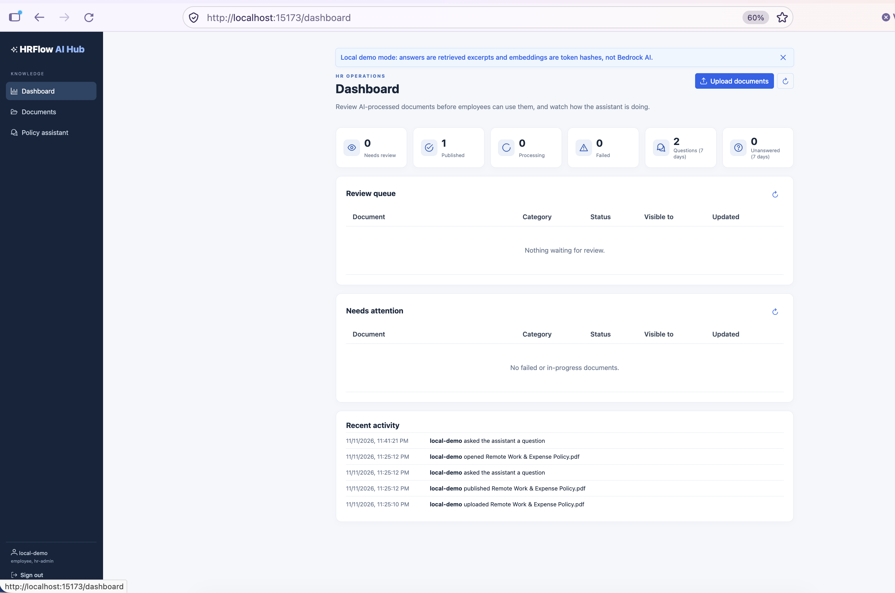
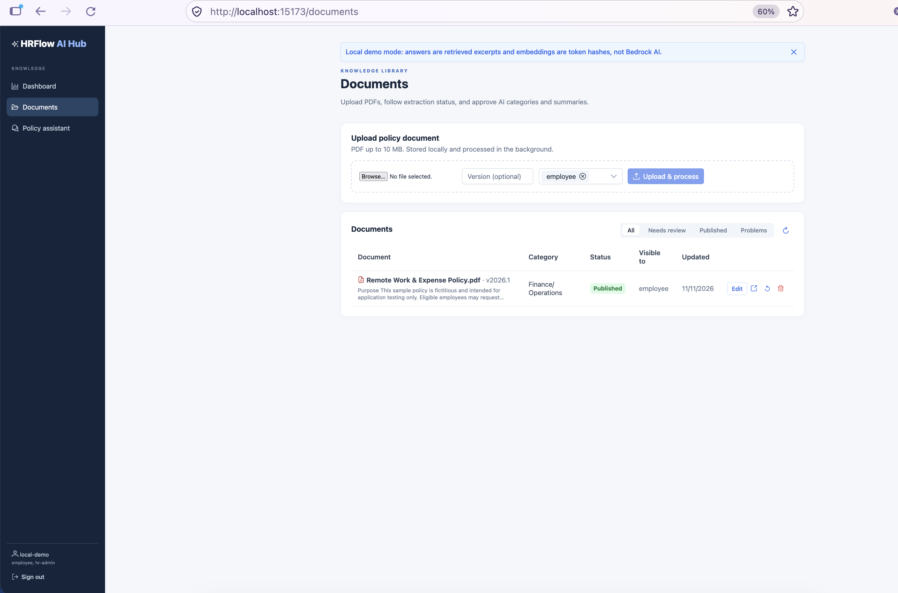
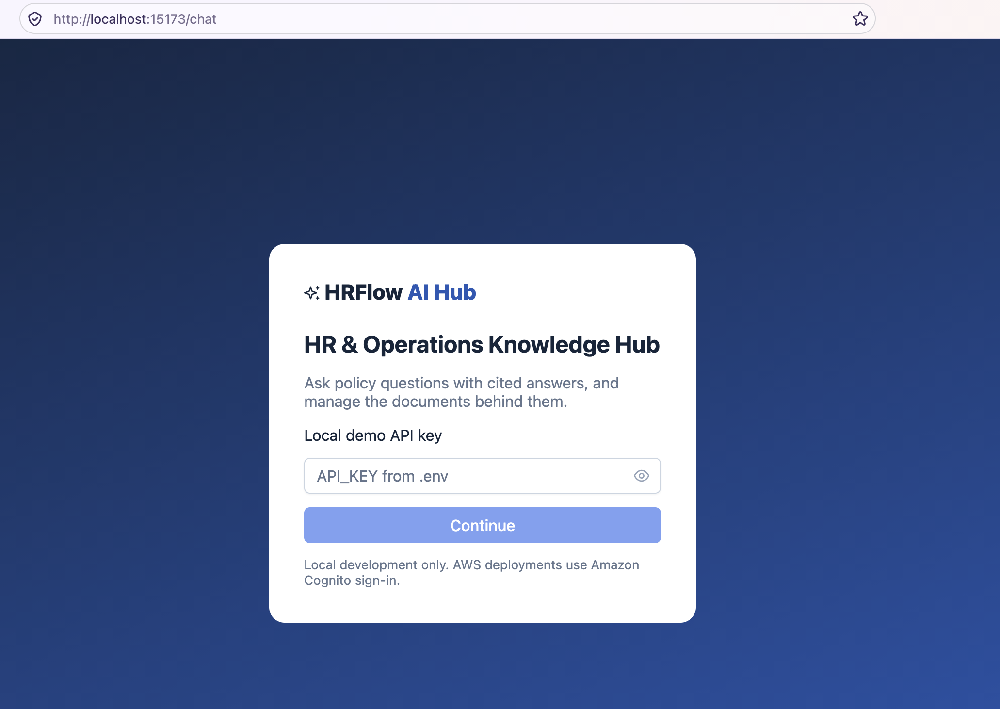
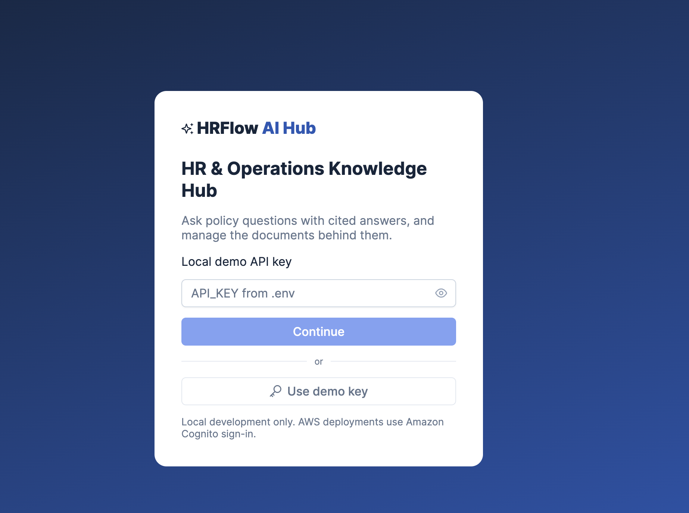

# HRFlow AI Knowledge Hub

[](https://github.com/anisur-rahman/hrflow-ai-knowledge-hub-aws/actions/workflows/ci.yml)
[](https://github.com/anisur-rahman/hrflow-ai-knowledge-hub-aws/releases/latest)
[](LICENSE)
[](https://github.com/anisur-rahman?tab=packages&repo_name=hrflow-ai-knowledge-hub-aws)
[](https://github.com/anisur-rahman/hrflow-ai-knowledge-hub-aws/commits/main)
[](https://github.com/astral-sh/ruff)

[](https://www.python.org/)
[](https://fastapi.tiangolo.com/)
[](https://vuejs.org/)
[](https://www.typescriptlang.org/)
[](https://primevue.org/)
[](https://github.com/pgvector/pgvector)
[](https://aws.amazon.com/bedrock/)
[](https://aws.amazon.com/)
[](infrastructure/terraform)
[](docker-compose.yml)

An AI-enabled HR & Operations knowledge hub. HR uploads policy PDFs, AI proposes a category and summary, HR reviews and publishes, and employees ask questions in plain language and get answers grounded in the published policies, with page citations that open the source PDF.

**Stack:** Vue 3 + TypeScript + PrimeVue · Python + FastAPI · PostgreSQL + pgvector · Amazon Bedrock (Titan Text Embeddings V2 + a Converse chat model) · S3 · SQS · Lambda · Textract · ECS Fargate · API Gateway · Cognito · RDS · CloudWatch · GitHub Actions + ECR · Terraform

> **New here?** Follow the **[step-by-step guide](docs/GETTING_STARTED.md)**: run locally in 15 minutes with no AWS account, develop and test, deploy to your own AWS account with GitHub Actions, and tear it down.

## Contents

- [Screenshots](#screenshots)
- [Architecture](#architecture)
- [Project structure](#project-structure)
- [Quick start (local, no AWS account)](#quick-start-local-no-aws-account)
- [Tests](#tests)
- [Production readiness: what is and isn't done](#production-readiness-what-is-and-isnt-done)
- [API](#api)
- [License](#license)
- [Step-by-step guide](docs/GETTING_STARTED.md)
- [Deploy to AWS from the command line](docs/DEPLOY_AWS_CLI.md)
- [Choosing the Amazon Bedrock models](docs/BEDROCK_MODELS.md)
- [Contributing](CONTRIBUTING.md)
- [Security policy](SECURITY.md)
- [Changelog](CHANGELOG.md)

## Screenshots

| HR dashboard | Document library |
|---|---|
|  |  |

| Sign-in (local mode) | One-click demo key |
|---|---|
|  |  |

AWS deployments use Cognito hosted-UI sign-in instead of the local API key.

## Architecture

```text
Document ingestion
  Vue ──► API Gateway ──► FastAPI (ECS) ── presigned POST ──► Vue uploads PDF straight to private S3
  S3 ObjectCreated ──► SQS (DLQ after 3 tries) ──► ingest_lambda
     ├─ PyMuPDF text + heading detection
     │    └─ scanned PDF? start async Textract and stop ──► Textract ──► SNS ──► SQS ──► textract_callback
     ├─ Bedrock: category + proposed summary
     ├─ page-aware overlapping chunks with section headings
     └─ Bedrock Titan embeddings ──► RDS PostgreSQL + pgvector ──► status "pending_review"
  HR reviews / edits ──► "published"  (only published documents are ever retrieved)

Employee question
  Vue ──► API Gateway (Cognito JWT check) ──► FastAPI
     ├─ verify token again, read Cognito groups
     ├─ Bedrock embedding of the question
     ├─ pgvector search, filtered in SQL to published documents shared with the user's groups
     └─ Bedrock Converse with only that evidence ──► answer + citations (title, version, page, section, PDF link)
```

| Concern | Implementation |
|---|---|
| Entry point | API Gateway HTTP API → VPC link → internal ALB → ECS Fargate (`api` and `web` services) |
| Auth | Cognito hosted UI (authorization code + PKCE). API Gateway JWT authorizer, and the API verifies the access token again. Groups: `hr-admin`, `employee` |
| Authorization | Each document has `allowed_groups`; retrieval filters by group in SQL *before* any text reaches the LLM |
| Review workflow | `awaiting_upload → queued → processing → pending_review → published / rejected`, or `failed` (with reason, retry, reprocess) |
| Ingestion | Same Python services locally (background task) and in two Lambdas: `ingest_lambda` and `textract_callback`. No Lambda waits on OCR. Idempotent (row lock + status checks + chunk replacement); SQS partial-batch failures + DLQs |
| Storage | Private, versioned, encrypted S3; TLS-only bucket policy; presigned POST capped at 10 MB; 5-minute presigned GET for citations |
| Database | RDS PostgreSQL 17 + pgvector HNSW index; password managed by Secrets Manager; Alembic migrations behind an advisory lock |
| Observability | JSON logs with request IDs → CloudWatch metric filters (ingestion outcomes, chat latency, questions with no evidence, Bedrock tokens) → alarms + dashboard |
| CI/CD | CI: ruff, pytest against real pgvector, type-checked build, `npm audit`, `terraform validate`, image builds. Deploy: GitHub OIDC → ECR → `terraform apply` → wait for ECS → smoke test |

## Project structure

```text
hrflow-ai-knowledge-hub-aws/
│
├── frontend/                          # Vue 3 + TypeScript + PrimeVue
│   ├── src/
│   │   ├── components/
│   │   │   ├── DocumentUpload.vue     # PDF picker, version, visibility groups
│   │   │   ├── DocumentList.vue       # status table, filters, row actions
│   │   │   ├── ReviewDialog.vue       # approve / edit AI category & summary
│   │   │   └── AIChatbot.vue          # conversation with clickable citations
│   │   ├── views/
│   │   │   ├── DashboardView.vue      # HR: review queue, stats, activity
│   │   │   ├── DocumentsView.vue      # upload + document library
│   │   │   ├── ChatView.vue           # employee policy assistant
│   │   │   └── LoginView.vue          # Cognito sign-in / local demo key
│   │   ├── services/
│   │   │   ├── api.ts                 # typed REST client, uploads, source links
│   │   │   ├── auth.ts                # Cognito OIDC (code + PKCE) / API key
│   │   │   ├── session.ts             # app config + signed-in profile
│   │   │   └── documents.ts           # document store with status polling
│   │   ├── router/
│   │   │   └── index.ts               # routes + HR-only guard
│   │   ├── App.vue
│   │   └── main.ts
│   ├── nginx.conf                     # SPA hosting + security headers
│   ├── package.json
│   └── Dockerfile
│
├── backend/
│   ├── app/
│   │   ├── main.py                    # FastAPI app, middleware, health, config
│   │   ├── api/
│   │   │   ├── documents.py           # library, presigned upload, source links
│   │   │   ├── chat.py                # RAG question answering
│   │   │   └── admin.py               # review, reprocess, delete, stats, audit
│   │   ├── services/
│   │   │   ├── s3_service.py          # presigned POST/GET, local storage
│   │   │   ├── extraction.py          # PyMuPDF + headings, async Textract
│   │   │   ├── classification.py      # Bedrock document category
│   │   │   ├── summarization.py       # Bedrock proposed summary
│   │   │   ├── chunking.py            # page-aware overlapping chunks
│   │   │   ├── embeddings.py          # Titan Text Embeddings V2
│   │   │   ├── vector_store.py        # pgvector storage + authorized search
│   │   │   ├── rag_service.py         # grounded answers with citations
│   │   │   ├── ingestion.py           # pipeline orchestration (idempotent)
│   │   │   ├── bedrock.py             # shared Bedrock client
│   │   │   └── audit.py               # audit trail
│   │   ├── models/                    # SQLAlchemy: Document, Chunk, Audit
│   │   ├── schemas/                   # Pydantic request/response models
│   │   ├── security/                  # Cognito JWT verification, group access
│   │   ├── observability.py           # JSON logs -> CloudWatch metrics
│   │   └── config.py
│   ├── migrations/                    # Alembic (pgvector, HNSW index)
│   ├── requirements.txt
│   └── Dockerfile
│
├── workers/
│   ├── ingest_lambda/
│   │   └── handler.py                 # S3 upload event -> ingestion
│   ├── textract_callback/
│   │   └── handler.py                 # Textract completion -> ingestion
│   ├── common.py                      # SQS partial batch handling
│   └── Dockerfile                     # one Lambda image, two handlers
│
├── infrastructure/
│   └── terraform/
│       ├── main.tf                    # providers, shared settings, ECR
│       ├── networking.tf              # VPC, subnets, NAT, security groups
│       ├── ecs.tf                     # internal ALB, Fargate api + web
│       ├── rds.tf                     # PostgreSQL 17 + pgvector
│       ├── s3.tf                      # private document bucket + events
│       ├── lambda.tf                  # SQS, SNS, DLQs, worker Lambdas
│       ├── iam.tf                     # least-privilege roles
│       ├── api_gateway.tf             # HTTP API, VPC link, JWT authorizer
│       ├── cognito.tf                 # user pool, hosted UI, groups
│       ├── monitoring.tf              # metric filters, alarms, dashboard
│       ├── variables.tf
│       ├── outputs.tf
│       └── bootstrap/                 # state bucket + GitHub OIDC role
│
├── tests/
│   ├── test_documents.py              # upload, review, publish, admin
│   ├── test_rag.py                    # grounding and citations
│   ├── test_security.py               # auth, groups, token checks
│   └── test_ingestion.py              # chunking, workers, async OCR
│
├── .github/workflows/
│   ├── ci.yml                         # lint, tests, build, terraform validate
│   └── deploy.yml                     # OIDC -> ECR -> terraform apply -> smoke test
│
├── samples/                           # demo policy + PDF generator
├── docs/screenshots/
├── docker-compose.yml
├── .env.example
└── README.md
```

## Quick start (local, no AWS account)

```bash
cp .env.example .env
docker compose up --build -d
```

**Skip the build:** run the published images from GitHub Container Registry instead (pin a release with `HRFLOW_VERSION=1.0.0`):

```bash
docker compose -f docker-compose.yml -f docker-compose.ghcr.yml up -d
```

Open http://localhost:5173 and click **Use demo key**. Local mode is offline (`AI_PROVIDER=mock`): embeddings are token hashes and answers are the best matching excerpt, so it shows the plumbing, not AI quality.

The **[step-by-step guide](docs/GETTING_STARTED.md)** covers everything else:

- [Part A](docs/GETTING_STARTED.md#part-a--run-it-locally-15-minutes-no-aws-account): run locally, port conflicts, the sample PDF and a walkthrough of the whole flow
- [Part B](docs/GETTING_STARTED.md#part-b--develop-and-contribute): tests, hot reload, migrations, real Bedrock locally, contributing
- [Part C](docs/GETTING_STARTED.md#part-c--deploy-to-aws): deploy to your AWS account with GitHub Actions (billable: about $80–120/month idle plus usage)
- [Deploy from the command line](docs/DEPLOY_AWS_CLI.md): the same deployment with AWS CLI, Docker and Terraform only, no GitHub Actions
- [Part D](docs/GETTING_STARTED.md#part-d--tear-down-aws): tear down

## Tests

`docker compose --profile test run --rm tests` runs everything against a real PostgreSQL + pgvector (CI runs the same suite on every push).

- `test_documents.py`: upload → processing → review edits → publish, validation, failures and reprocess, deletion, dashboard stats and audit trail.
- `test_rag.py`: only published evidence is used, citations (title, version, page, section, PDF link), follow-up questions, the model is never called without evidence, prompt construction, AI output parsing.
- `test_security.py`: API key and Cognito token checks (wrong client, ID token, expired, wrong issuer, forged signature), admin-only endpoints, group-based visibility in lists, downloads and retrieval, configuration guards.
- `test_ingestion.py`: chunking and headings, both Lambda handlers, and the async Textract flow (start, duplicate events, completion, failed job, transient error retried).

## Production readiness: what is and isn't done

Done in this repository: everything in the tables above, with tests.

Known limits and next steps:
- **Very large documents:** OCR runs asynchronously in Textract, but embedding happens in a single Lambda invocation (10-minute timeout, 100-page cap). For much larger documents, fan the embedding out across SQS messages, or use Step Functions or a Fargate worker.
- **API Gateway's 30-second integration timeout** limits chat. Long answers would need streaming (for example WebSockets or Lambda response streaming).
- **Retrieval quality:** add hybrid keyword + vector search, reranking, and an evaluation set of real policy questions with expected answers and pages before trusting answers about amounts or deadlines. The model is told to quote limits only from the evidence, and every answer shows its sources, but answers still need human-verifiable citations.
- **Security hardening:** scope the GitHub deploy role (currently AdministratorAccess, limited to the protected environment), add AWS WAF on API Gateway, use a KMS CMK for S3/RDS if required, and add malware scanning for uploads.
- **Operations:** NAT gateway per AZ, Multi-AZ RDS (`db_multi_az = true`), `deletion_protection = true`, a custom domain with ACM, and a retention policy for documents and audit events.
- Do not upload real employee data or PII until the above have been reviewed by your security team.

## API

| Method & path | Who | Purpose |
|---|---|---|
| `GET /health`, `/health/ready` | public | liveness / database readiness |
| `GET /api/config` | public | auth mode and Cognito settings for the SPA |
| `GET /api/me` | signed in | username, groups, admin flag |
| `GET /api/documents` | signed in | admins: all documents; others: published documents shared with their groups |
| `POST /api/documents` | hr-admin | create a record, returns a presigned S3 POST (or the local upload URL) |
| `POST /api/documents/{id}/file` | hr-admin | local storage only: upload the PDF |
| `GET /api/documents/{id}/source` | can see the document | short-lived link to the original PDF |
| `PATCH /api/documents/{id}/review` | hr-admin | approve (with edits) or reject |
| `POST /api/documents/{id}/reprocess` | hr-admin | re-run ingestion |
| `DELETE /api/documents/{id}` | hr-admin | delete the file, chunks and record |
| `POST /api/chat` | signed in | `{question, history}` → `{answer, sources[]}` |

Swagger UI is at http://localhost:8000/docs locally (it is disabled outside `ENVIRONMENT=local`).

## Contributing

Contributions are welcome! See [CONTRIBUTING.md](CONTRIBUTING.md) for the workflow, coding standards and the checks a pull request must pass. Please follow the [Code of Conduct](CODE_OF_CONDUCT.md).

## License

[MIT](LICENSE) © 2026 Md Anisur Rahman
